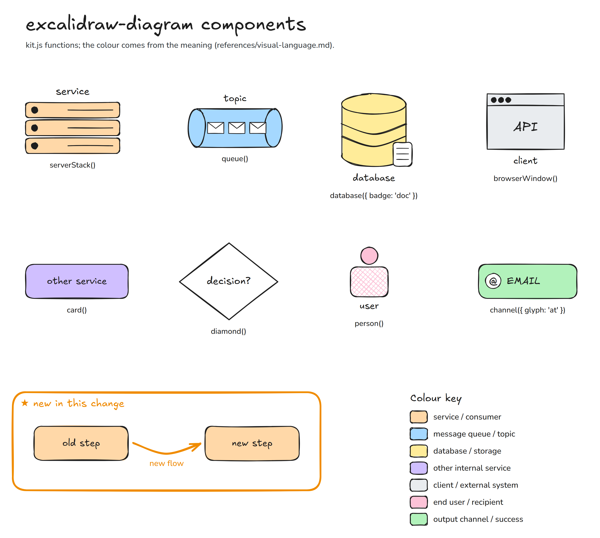

# Components (lib/kit.js)



```js
const d = kit.createDiagram();                 // { style: 'clean' } for the straight style
```

Every `color` option (`serverStack`, `browserWindow`, `card`, `lifeline`) accepts a palette key or a hex colour `'#rrggbb'`. A hex colour is used as-is and is not listed in the colour key; add it with `legend({ extra: [{ color, label }] })`. Anything else throws `unknown palette key`.

Every component returns a **bbox** `{ x, y, w, h, below, above, main, bind }` (`main` = the visible shape, change its
colour or corners there; `bind` = an invisible frame over the icon, its name and its note — arrows bind to it, so an
editor that re-snaps an arrow keeps it outside that text). Pass it to `d.link`. `below` = height of the text under the icon, `above` = height of the text above it (a 't' link stops above it). Coordinates are the icon's top-left corner; names above / below the icon are not inside `w × h`.

The sheet shows the common components; `frame`, `lifeline` and the `data` / `fail` / `parallel` arrow kinds are described in the tables below.

| Function | Options (defaults) | Draws |
|---|---|---|
| `serverStack` | `x, y, w=220, label, note?, color='service'` | 3 stacked server boxes, name above, note below |
| `queue` | `x, y, w=220, h=90, label, labelBelow=false` | horizontal cylinder with 3 envelopes (always `queue` blue) |
| `database` | `x, y, w=150, h=170, label, note?, badge?: 'doc'\|'file'` | vertical cylinder (always `data` yellow) |
| `browserWindow` | `x, y, w=180, h=130, label, caption='API', color='external'` | window with 3 dots; caption inside, label below |
| `card` | `x, y, w=240, h=80, label, color='other', size=22, note?` | rounded box, label inside |
| `diamond` | `x, y, w=230, h=180, label` | white decision diamond |
| `person` | `x, y, label='user', note?` | head + body, label and note below |
| `channel` | `x, y, w=230, h=80, label, glyph` | green pill; glyph `inbox`, `phone`, `doc`, `envelope`, `at` |
| `lifeline` | `x, y, w=220, h=70, label, color='service', length=600` | card + dashed vertical line; adds `cx`, `bottom` |

Layout helpers:

| Function | Options | Notes |
|---|---|---|
| `frame` | `x, y, w, h, label` | dashed grey boundary |
| `highlight` | `x, y, w, h, kind='new'\|'problem', title` | one per diagram |
| `title` | `x=0, y=0, text, subtitle?` | top-left |
| `legend` | `x, y, title='Colour key', extra=[]` | call last; lists only the palette colours used, then the `extra` rows `{ color, label }` (`color` = palette key or hex) |
| `note` | `x, y, w=400, text, size=18, align='left', color, font='plain'\|'hand'` | free text |
| `line` | `points, kind='main'` | free line (timeline axis, ticks) |

Arrows:

| Function | Signature | Notes |
|---|---|---|
| `link` | `link(from, fromSide, to, toSide, { kind='main', bend=25, via?, label?, labelAt?, labelColor? })` | sides `r l t b`; kinds `main data parallel fail new`; `bend` = sideways offset of the middle (0 = straight); `via` = absolute points the curve passes through, used instead of the automatic bend (`bend` is then ignored) |
| `message` | `message(fromLifeline, toLifeline, y, { label?, kind?, reply? })` | straight; `reply` = dashed; same lifeline = self loop |

A `.diagram.js` script:

```js
module.exports = kit => {
  const d = kit.createDiagram();
  // … components, links …
  d.legend({ x: 0, y: 900 });
  return [{ slug: 'my-subject-flow', diagram: d }];   // several entries = several diagrams
};
```

Adding a component: write it in `lib/kit.js` next to the others (return `bbox(…)`, group its parts, use `fill(key)`
for the colour), add it to the API object, a test in `tests/kit.test.js`, a row here, and a caption in
`examples/components-sheet.diagram.js`.
